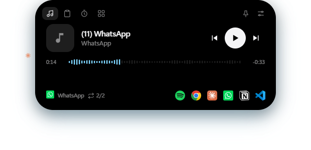

# Isla

Una isla flotante para Windows. Vive como una línea finita arriba de la pantalla; la tocás (o pasás el mouse) y se abre con lo que está pasando en tu PC: la canción que suena, lo último que copiaste, un temporizador, tus apps, y avisos que aparecen solos cuando importan.

Es gratis, no tiene cuenta ni premium, y todo lo personal (portapapeles, notificaciones) queda en tu PC.



## Instalar

1. Bajá **`Isla-Setup-x.y.z.exe`** de la sección [Releases](../../releases).
2. Abrilo. Windows puede mostrar "Windows protegió su PC" porque el instalador no está firmado: tocá **Más información → Ejecutar de todas formas**.
3. Listo: queda un acceso directo en el escritorio y en el menú Inicio, y la isla aparece arriba de la pantalla.

¿No querés instalar nada? Bajá **`Isla-x.y.z-portable.exe`** y abrilo directamente.

Para que arranque con Windows: clic derecho en el ícono de la bandeja → **Iniciar con Windows**.

Requisitos: Windows 10 u 11 (64 bits).

## Qué hace

**Música**
- Lo que suena en Spotify, el navegador, YouTube, WhatsApp o cualquier app que use los controles multimedia de Windows.
- Carátula, controles, barra para adelantar y letra sincronizada (de lrclib.net).
- El color de la isla toma el de la carátula. El cambio de canción es instantáneo.

**Portapapeles**
- Historial de lo que copiás (texto, links, imágenes). Click para volver a copiar, fijar o borrar.
- No guarda lo que copian los gestores de contraseñas, y podés excluir apps.

**Avisos que aparecen solos** (cada uno se apaga en la configuración)
- Llamadas de WhatsApp, Teams o Zoom, y notificaciones de mensajes.
- Próxima reunión con botón para unirte (pegando la dirección iCal secreta de tu Google Calendar u Outlook).
- Descargas en curso y terminadas.
- Capturas de pantalla: Win+Shift+S y la miniatura cae en la isla para arrastrarla a cualquier app.
- Micrófono y cámara en uso: un punto naranja o verde al lado de la isla.
- Fútbol: partido en vivo de tu equipo y avisos de gol de la Champions, la Premier, la Liga Argentina y los equipos que elijas.
- Dólar blue, alternando con el reloj.
- Claude Code: qué está haciendo, cuándo necesita permiso y cuándo terminó.

**Más**
- Temporizador y cronómetro, con borde que se va llenando.
- Lanzador de apps con sus íconos reales.
- Volumen con la rueda del mouse, avisos de batería.
- Se esconde sola con apps en pantalla completa.
- Atajo **Alt+H** para mostrar u ocultar.

## Cómo se usa

- **Click en la línea**: pasa a cápsula y queda así.
- **Click en la cápsula**: se abre.
- **Doble click**: vuelve a ser línea.
- **Rueda horizontal**: cambia de pestaña. **Rueda vertical**: volumen.
- **Ícono de ajustes** (arriba a la derecha de la isla abierta): colores, forma, qué avisos mostrar y más.

## Privacidad

- El portapapeles y las notificaciones se leen y se guardan solo en tu PC (`%APPDATA%\isla`).
- Lo único que sale a internet: la letra de las canciones (lrclib.net), el dólar (dolarapi.com), los resultados de fútbol (ESPN) y tu calendario, si cargás la dirección iCal.
- La integración con Claude Code agrega hooks a `~/.claude/settings.json` sin tocar los tuyos y deja una copia en `settings.json.antes-de-isla`. Se quitan apagando la opción.

## Desarrollo

Necesitás [Node.js](https://nodejs.org) 20 o más nuevo.

```bash
npm install
npm start
```

Para generar el instalador y la versión portable en `dist/`:

```bash
npm run dist
```

Si falla con "Cannot create symbolic link", activá el Modo de desarrollador de Windows o corré la terminal como administrador una vez.

### Cómo está hecho

- **Electron**: una ventana transparente, sin marco y siempre arriba que deja pasar los clicks cuando el mouse no está sobre la isla.
- **PowerShell**: scripts que hablan con Windows y mandan JSON por línea:
  - `media.ps1`: controles multimedia (SMTC)
  - `system.ps1`: volumen, batería, ventana activa, micrófono y cámara
  - `notifs.ps1`: notificaciones
  - `apps.ps1`: apps del menú Inicio
- `src/services.js`: dólar, fútbol, calendario, descargas y el servidor local para Claude Code.
- `src/index.html`: la isla. `src/settings.html`: la configuración.

## Licencia

MIT
